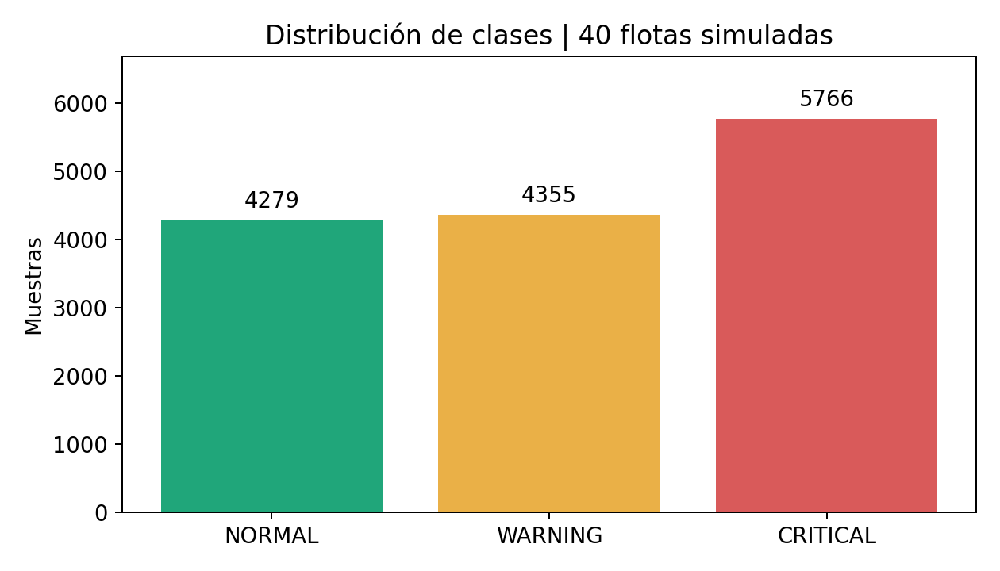
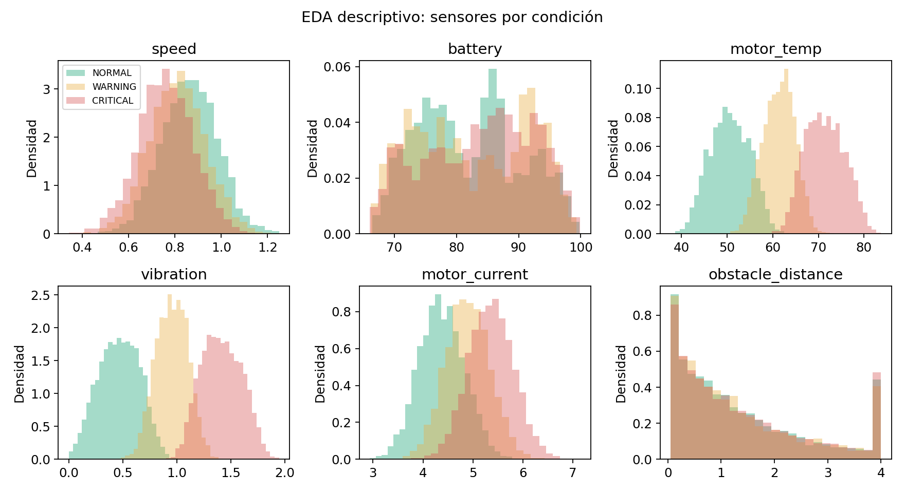
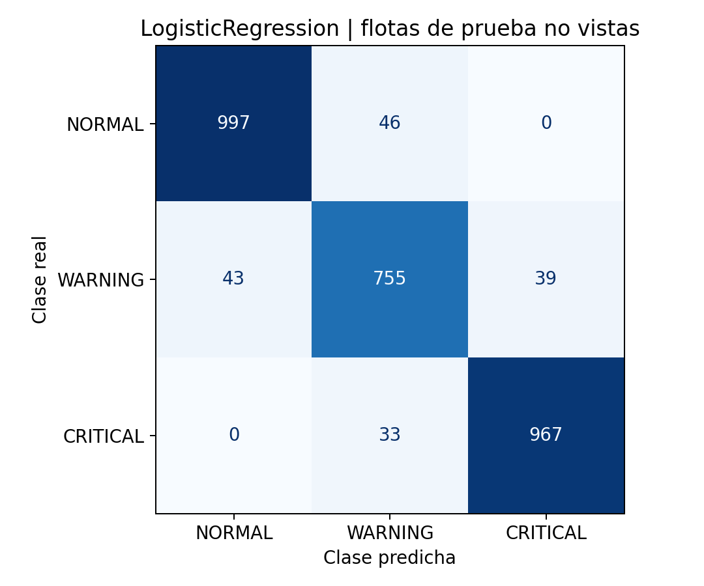

# Evidencia del modelo - Cloud Fleet

## Datos y exploración

Dataset sintético: 14,400 muestras, 40 flotas, generadas con el simulador original sin modificar sus ecuaciones.
La etiqueta procede de la salud interna del simulador, que NO se entrega al modelo.
Semilla base: 606. Las semillas de flota se incrementan en 1009.
Distribución: {'NORMAL': 4279, 'WARNING': 4355, 'CRITICAL': 5766}.

La vibración y la temperatura aumentan al deteriorarse la salud según el simulador.
La batería también depende del tiempo de ejecución; no debe interpretarse como causa de una avería.
Los histogramas son descriptivos; no se usaron para reajustar modelos tras consultar el test.

## Separación sin fuga entre flotas

Dos GroupShuffleSplit con semillas 606 y 607; reparto 60/20/20 por flota.
Ninguna flota aparece en dos particiones. Las proporciones de clases no son idénticas porque se separan grupos completos.

| Partición | Flotas | Filas |
|---|---:|---:|
| train | 24 | 8640 |
| validation | 8 | 2880 |
| test | 8 | 2880 |

Se excluyen fleet_id, robot_id, timestamp, x e y para evitar memorizar identidades, tiempo o posición.
Variables usadas: speed, battery, motor_temp, vibration, motor_current, obstacle_distance.
El preprocesamiento se ajusta dentro de cada Pipeline, después de separar los datos.

## Comparación y selección

| Clasificador | F1 macro de validación | Entrenamiento (s, este entorno) |
|---|---:|---:|
| LogisticRegression | 0.9223 | 0.076 |
| RandomForest | 0.9159 | 2.324 |

Se elige **LogisticRegression** por el mayor F1 macro de validación.
Regresión logística: modelo lineal con estandarización; pequeño y rápido.
Random Forest: aprende interacciones y umbrales no lineales; consume más memoria e inferencia.
Ambos ponderan las clases para dar atención a las menos frecuentes.
Se reentrena solo el ganador con entrenamiento + validación y se evalúa una vez en prueba.

## Resultado reservado de prueba

- F1 macro del ganador: **0.9417**.
- F1 macro de la línea base de clase mayoritaria: **0.1718**.
- Matriz: etiquetas NORMAL, WARNING, CRITICAL; filas reales y columnas predichas.

F1 macro promedia el F1 de las tres clases por igual; evita que una clase abundante oculte malos resultados en las otras.
Los números por clase están en metrics.json. La probabilidad máxima es una confianza del modelo, no una probabilidad calibrada ni una garantía.

## Reproducibilidad y límites

Pipeline: models/model.joblib. Versión: v1; scikit-learn 1.8.0.
Hash del dataset: cef188c31f7974aae8e0464681ecab5f2fbd7f9ae73463bb47280995a82b3369.
Hash del modelo: f281359fd5503c3afdad981c7d8ee1e6e2e5a7cd8ec6adf7c47122c6ca7c1152.
La asignación de flotas está en metrics.json. split_assignments.csv se regenera al ejecutar el entrenamiento opcional. Dependencias fijadas en requirements.txt.

Estos resultados corresponden a flotas sintéticas no vistas del mismo generador.
No prueban funcionamiento en robots físicos ni anticipan el F1 de la flota privada del docente.
El EDA muestra todo el dataset con fin documental; la selección usa solo validación.
El servicio no se reentrena con la telemetría que recibe.
